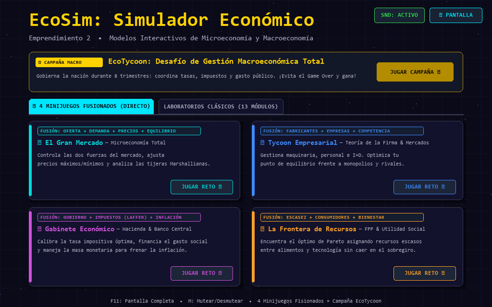
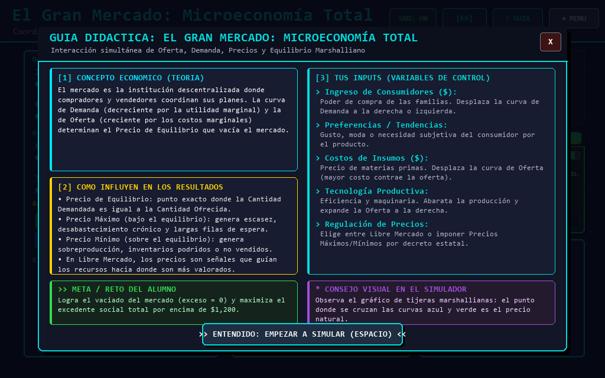
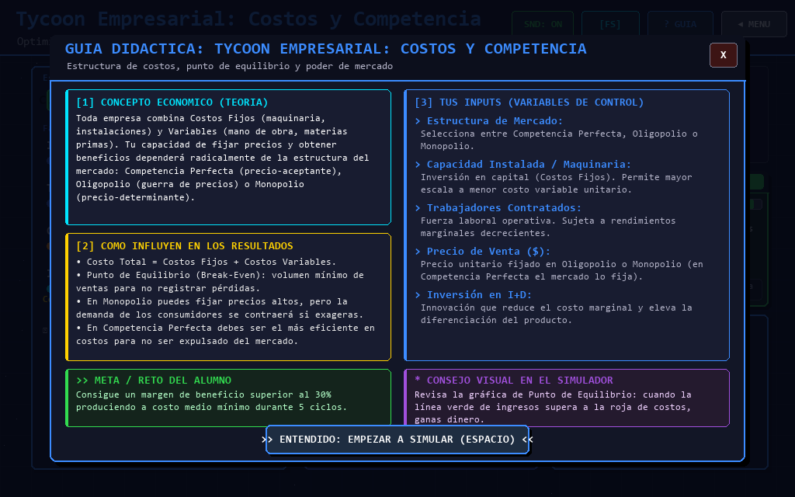
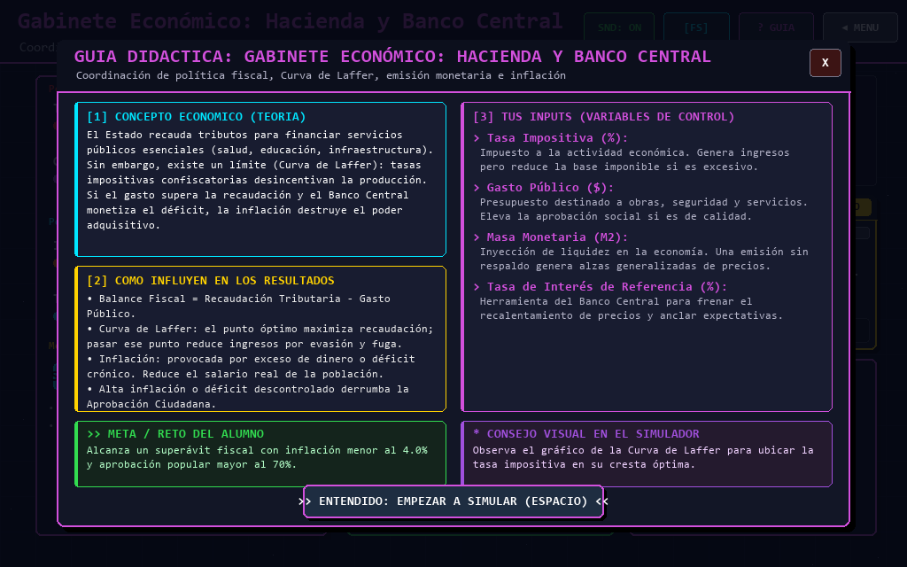
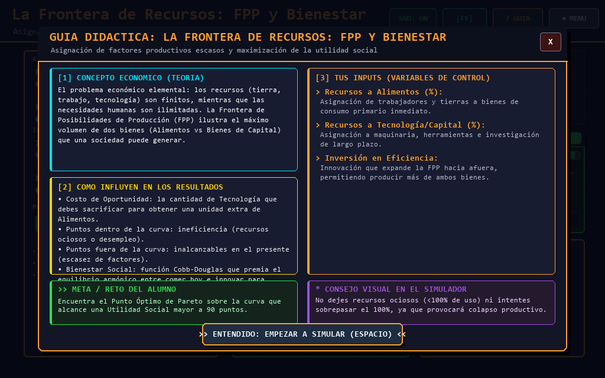
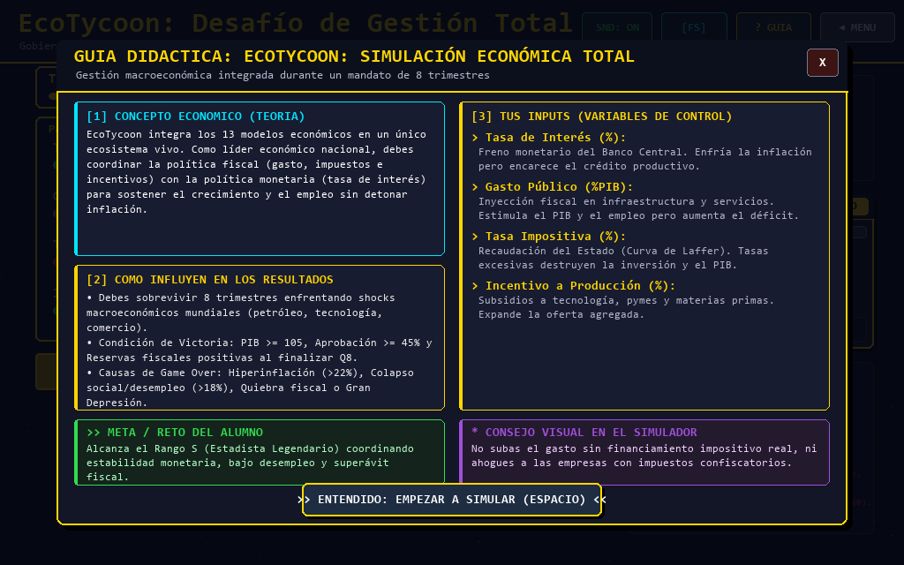

<div align="center">

# 📈 EcoSim: Economics Rise
### *Simulador Económico Interactivo & Laboratorio de Gestión en Pygame*

[](https://www.python.org/)
[](https://www.pygame.org/)
[](https://github.com/)
[](LICENSE)
[]()

<br/>



*Plataforma interactiva de microeconomía y macroeconomía con estética retro pixel-art, simulación matemática en tiempo real, monitor de salud adaptativo y campaña macroeconómica integrada.*

---

[🎮 Modos de Juego](#-experiencias-y-minijuegos-fusionados) • 
[🏆 Campaña EcoTycoon](#-campaña-ecotycoon-gestión-macroeconómica-total) • 
[📐 Modelos Matemáticos](#-fundamento-teórico-y-matemático) • 
[⌨️ Controles](#️-controles-y-atajos) • 
[🚀 Instalación](#-instalación-y-ejecución) • 
[📦 Compilación a EXE](#-compilación-a-ejecutable-independiente-exe)

</div>

<br/>

## 🌟 Acerca del Proyecto

**EcoSim: Economics Rise** es una herramienta pedagógica gamificada diseñada para la enseñanza moderna de la economía y el emprendimiento. Permite a estudiantes, docentes y entusiastas experimentar de forma práctica cómo interactúan las variables económicas mediante sliders interactivos, simulaciones gráficas en vivo y retroalimentación inmediata.

A diferencia de simuladores estáticos o puramente teóricos, EcoSim implementa:
* **Fórmulas formales rigurosas:** Cobb-Douglas, Tijeras Marshallianas, Curva de Laffer, Ecuación Cuantitativa del Dinero ($MV = PQ$) y Fronteras de Posibilidades de Producción (FPP) cóncavas.
* **Mascota reactiva con IA de evaluación:** Un robot pixel-art con partículas dinámicas que diagnostica en tiempo real si tus decisiones son óptimas, regulares o si estás al borde de la quiebra.
* **Audio y feedback sensorial:** Música 8-bit chiptune y efectos de sonido procedimentales sintetizados en tiempo real.
* **Resolución dinámica:** Soporte para pantalla completa (`F11`) y escalado automático de interfaz con protección contra solapamiento.

---

## 🎮 Experiencias y Minijuegos Fusionados

Los módulos académicos clásicos han sido consolidados en **4 grandes simuladores integrados**, permitiendo observar la relación directa entre causas y efectos en un solo ecosistema:

---

### 1. ⚖️ El Gran Mercado: Microeconomía Total
> **Módulos integrados:** `Oferta` + `Demanda` + `Precios` + `Equilibrio` + `Plaza de Mercado`



* **Tijeras Marshallianas en vivo:** Observa cómo se cruzan las curvas de Oferta $S(P)$ y Demanda $D(P)$ calculadas matemáticamente en tiempo real.
* **Desplazadores de Curva:** Altera el ingreso familiar y las preferencias del consumidor para desplazar la Demanda; modifica el costo de materias primas y la tecnología para desplazar la Oferta.
* **Controles y Regulaciones Estatales:** Comprueba qué sucede al decretar **Precios Máximos** (provocando escasez, mercado negro y filas de espera) o **Precios Mínimos** (causando sobreproducción y stock acumulado).
* **Plaza de Comercio Animada:** Compradores y vendedores pixel-art interactúan visualmente reflejando la satisfacción del mercado.

---

### 2. 🏭 Tycoon Empresarial: Costos, Producción y Competencia
> **Módulos integrados:** `Fabricantes` + `Empresas` + `Competencia`



* **Teoría de la Firma:** Función de producción Cobb-Douglas donde combinas Inversión en Capital / Maquinaria (Costos Fijos) con Obreros e Insumos (Costos Variables).
* **Gráfica de Punto de Equilibrio (Break-Even):** Visualiza la intersección exacta donde el Ingreso Total iguala al Costo Total, delimitando la zona de beneficios de la de pérdidas operativas.
* **Estructuras de Mercado:**
  * **Competencia Perfecta:** Eres precio-aceptante y vendes a costo marginal.
  * **Oligopolio:** Compites contra empresas rivales donde un precio muy alto desvía tu cuota de mercado.
  * **Monopolio:** Poder absoluto de fijación de precios, condicionado por la elasticidad de los consumidores.
* **Planta Industrial Animada:** Chimeneas con partículas de humo, operarios en faena y almacén de productos terminados.

---

### 3. 🏛️ Gabinete Económico: Hacienda y Banco Central
> **Módulos integrados:** `Gobierno` + `Impuestos` + `Inflación`



* **Curva de Laffer en Tiempo Real:** Demuestra experimentalmente que elevar la tasa impositiva por encima del óptimo ($\approx 42\%$) reduce la recaudación tributaria debido a la evasión y la contracción de la base económica (Zona Ineficiente).
* **Coordinación Fiscal y Monetaria:** Equilibra la recaudación y el gasto público en obras sociales frente a la emisión de masa monetaria (M2) y la tasa de interés del Banco Central.
* **Termómetro de Inflación & Salario Real:** Monitoriza la pérdida de poder adquisitivo del pueblo cuando el déficit es financiado con emisión descontrolada.
* **Arcas del Tesoro:** Muestra el superávit o déficit fiscal y su repercusión directa en la Aprobación Ciudadana.

---

### 4. 🏝️ La Frontera de Recursos: FPP y Bienestar
> **Módulos integrados:** `Escasez` + `Consumidores` (Utilidad y Preferencias)



* **El Problema Económico Fundamental:** Asignación de factores finitos (100% de recursos) entre dos bienes vitales: **Alimentos** (consumo inmediato) y **Bienes de Capital/Tecnología** (futuro).
* **FPP Cóncava con Rendimientos Decrecientes:** Curva elíptica que modela la ley de costos de oportunidad crecientes (Tasa Marginal de Transformación).
* **Dilema de Eficiencia vs Inviabilidad:**
  * **Dentro de la curva:** Recursos ociosos y desempleo.
  * **Sobre la curva:** Asignación eficiente y Óptimo de Pareto.
  * **Fuera de la curva:** Asignación imposible / sobreexplotación destructiva.
* **Función de Utilidad Social:** Premia la armonía entre alimentar a la sociedad actual y capitalizar la tecnología de mañana.

---

## 🏆 Campaña EcoTycoon: Gestión Macroeconómica Total



EcoTycoon es el modo de juego insignia que integra todas las variables de la economía nacional en un **mandato de 8 trimestres**:

* **Palancas de Mando:** Tasa de Interés del Banco Central, Gasto Público (% PIB), Tasa Impositiva y Subsidios a la Producción.
* **Indicadores Clave:** Crecimiento del PIB, Inflación Interanual, Tasa de Desempleo, Poder Adquisitivo, Aprobación Popular y Reservas Fiscales ($M).
* **Shocks Macroeconómicos Aleatorios:** Crisis petroleras, booms de exportación, pandemias, saltos de productividad y huelgas laborales.
* **Condiciones de Victoria y Ranking:**
  * **Rango S (Estadista Legendario):** Crecimiento récord con estabilidad de precios y bajo desempleo.
  * **Rangos A, B y C:** Desempeño mixto con equilibrio presupuestario.
* **Condiciones Críticas de Game Over:**
  * ❌ *Hiperinflación descontrolada (>22%)*
  * ❌ *Colapso del PIB y desempleo masivo (>18%)*
  * ❌ *Bancarrota fiscal y agotamiento de reservas*
  * ❌ *Destitución política por descontento social (<20%)*

---

## 📐 Fundamento Teórico y Matemático

El motor de EcoSim implementa modelos formales de microeconomía y macroeconomía:

1. **Equilibrio Marshalliano:**
   $$Q_d(P) = A - \alpha P, \quad Q_s(P) = -B + \beta P \implies P^* = \frac{A + B}{\alpha + \beta}$$
2. **Función de Producción Cobb-Douglas:**
   $$Q = A \cdot K^{\alpha} \cdot L^{\beta}, \quad \text{con } \alpha + \beta \le 1$$
3. **Punto de Equilibrio Empresarial (Break-Even):**
   $$Q_{PE} = \frac{CF}{P - CV_{\text{unit}}}$$
4. **Curva de Laffer:**
   $$T(t) = t \cdot \text{Base}_0 \cdot \left(1 - \left(\frac{t}{100}\right)^\gamma\right)$$
5. **Teoría Cuantitativa del Dinero:**
   $$M \cdot V = P \cdot Y \implies \pi \propto \Delta M - \text{ancla}(i)$$
6. **Frontera de Posibilidades de Producción y TMT:**
   $$\left(\frac{X}{A}\right)^2 + \left(\frac{Y}{B}\right)^2 \le 1, \quad \text{TMT} = -\frac{dY}{dX}$$

---

## ⌨️ Controles y Atajos

| Tecla / Control | Acción |
| :---: | :--- |
| **Clic Izquierdo** | Interactuar con sliders, seleccionar botones de modo e ingresar a módulos |
| **Arrastrar Slider** | Modificar variables numéricas en tiempo real |
| **`ESC`** | Volver al Menú Principal desde cualquier escena / Salir |
| **`F11`** | Alternar entre Modo Ventana y Pantalla Completa nativa |
| **`M`** | Mutear / Desmutear la música y efectos de audio |
| **`H` o `F1`** | Abrir la Guía Pedagógica / Tutorial interactivo del módulo |
| **`Espacio` / `Enter`** | Cerrar el modal del tutorial y comenzar a simular |

---

## 🚀 Instalación y Ejecución

### Requisitos Previos
* **Python 3.10 o superior** ([Descargar Python](https://www.python.org/downloads/))
* Sistema Operativo: Windows 10/11, Linux o macOS

### 1. Clonar el Repositorio
```bash
git clone https://github.com/tu-usuario/economics-rise.git
cd economics-rise
```

### 2. Crear Entorno Virtual (Recomendado)
```bash
# En Windows:
python -m venv venv
.\venv\Scripts\activate

# En Linux / macOS:
python3 -m venv venv
source venv/bin/activate
```

### 3. Instalar Dependencias
```bash
pip install -r requirements.txt
```
*(O simplemente ejecuta con doble clic el archivo `instalar_dependencias.bat` en Windows).*

### 4. Ejecutar el Simulador
```bash
python main.py
```
*(O ejecuta con doble clic `JUGAR.bat`).*

---

## 📦 Compilación a Ejecutable Independiente (.EXE)

El proyecto incluye scripts preconfigurados con **PyInstaller** para generar un ejecutable autónomo sin necesidad de que el usuario final tenga Python instalado:

* **Compilar con carpeta de distribución:**
  ```bash
  .\compilar_a_exe.bat
  ```
  Genera la carpeta `dist/EcoSim/` con todos sus assets optimizados.
* **Compilar a un único archivo `.exe` portátil:**
  ```bash
  .\compilar_a_un_solo_exe.bat
  ```
  Genera un único archivo autocontenido `dist/EcoSim.exe`.

---

## 📁 Estructura del Proyecto

```plaintext
Economics Rise/
├── assets/
│   └── audio/              # Música 8-bit chiptune y loops de ambiente
├── docs/
│   └── screenshots/        # Capturas de pantalla de los 4 minijuegos y menús
├── game/
│   ├── audio.py            # Motor de sonido procedural y reproductor de música
│   ├── constants.py        # Paletas de color retro, dimensiones y configuración
│   ├── feedback.py         # Monitor de salud ModelHealthWidget y animaciones
│   ├── sprites.py          # Sprites pixel-art dibujados por código
│   ├── tutorials.py        # Base de conocimiento y modales pedagógicos
│   ├── ui.py               # Componentes UI: Sliders, Botones, Paneles, Gráficas
│   └── scenes/
│       ├── base.py         # BaseScene con navegación y gestión universal de eventos
│       ├── menu.py         # Menú principal con tarjetas fusionadas y filtros
│       ├── ecotycoon.py    # Campaña macroeconómica de 8 trimestres
│       ├── gran_mercado.py # Minijuego: Oferta, Demanda, Precios y Equilibrio
│       ├── empresa_tycoon.py# Minijuego: Costos, Break-Even y Competencia
│       ├── hacienda_banco.py# Minijuego: Curva de Laffer, Impuestos e Inflación
│       └── isla_recursos.py# Minijuego: FPP, Costo de Oportunidad y Utilidad
├── main.py                 # Ciclo principal de Pygame y enrutador de escenas
├── JUGAR.bat               # Acceso directo para ejecutar en Windows
├── compilar_a_exe.bat      # Script de empaquetado PyInstaller
└── requirements.txt        # Dependencias de Python (pygame, numpy)
```

---

## 📜 Licencia y Créditos

* **Desarrollo y Diseño Pedagógico:** Proyecto desarrollado para la asignatura de **Emprendimiento 2**.
* **Motor Gráfico & Lógica:** Construido en Python con [Pygame](https://www.pygame.org/) y [NumPy](https://numpy.org/).
* **Audio:** Efectos de sonido procedurales y loop musical 8-bit retro bajo licencia Creative Commons / Royalty-Free.
* **Licencia:** Distribuido bajo la Licencia MIT. Consulta `LICENSE` para más información.

<div align="center">
  <sub>Diseñado con pasión por la economía interactiva y los videojuegos retro.</sub>
</div>
